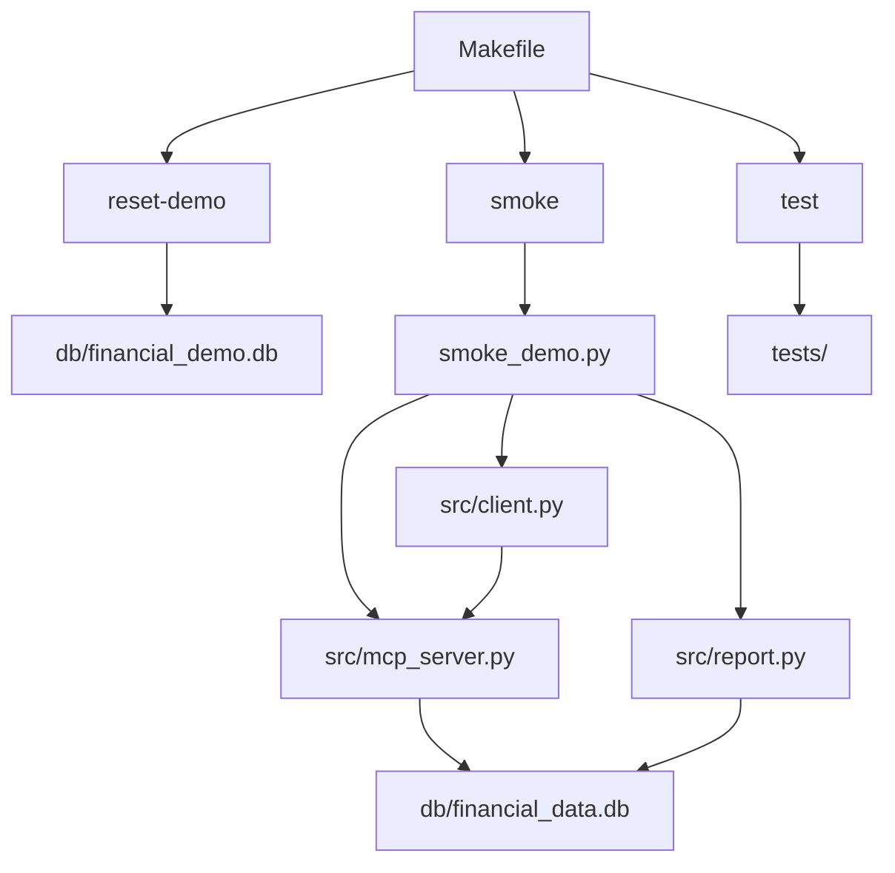

# financial-micro-saas

[](https://www.python.org/)
[]()
[]()
[]()

Micro-SaaS finanziario locale per orchestrare asset, prezzi e ottimizzazione di portafoglio tramite server MCP, con smoke demo e report di sistema già integrati.

## Overview

Il progetto combina un database locale, un server MCP, un client di verifica e un report testuale per validare il flusso end-to-end in modo rapido e ripetibile. L’obiettivo è avere un ambiente leggero ma completo per inizializzazione dati, test automatici, demo e operatività quotidiana. Il `Makefile` è il punto di ingresso principale e concentra i comandi più usati.

## Project Status

- `make install` funziona in editable mode.
- `make test` passa con la suite pytest.
- `make demo` completa seed, server, client e report.
- `make clean-release-bundle` pulisce correttamente l’output di release.
- Il progetto è operativo e coerente sul flusso base di sviluppo e verifica.

## Troubleshooting

- Se `make` fallisce con errori di sintassi, controlla che le recipe nel `Makefile` siano ancora valide e che non ci siano spazi al posto dei TAB.
- Se `make test` fallisce, esegui prima `make install` per assicurarti che il pacchetto sia installato in editable mode.
- Se la smoke demo non parte, verifica che il database demo sia stato rigenerato con `make reset-demo`.

## Architecture



- `Makefile` coordina installazione, test, demo e pulizia.
- `scripts/seed_demo.py` prepara il database demo.
- `src/mcp_server.py` espone i tool MCP.
- `src/client.py` valida handshake, tools e call operative.
- `src/report.py` genera il report di sistema.
- `tests/` copre inizializzazione DB e server MCP.

## Demo/Workflow

La demo segue un flusso pensato per essere ripetibile e leggibile anche fuori dal contesto di sviluppo. Prima si rigenera il seed demo, poi la smoke demo avvia installazione, server, client e report per verificare tutto il percorso. Alla fine ottieni una validazione concreta del sistema, non solo test unitari.

1. `make reset-demo` prepara il database demo da uno stato noto.
2. `make smoke` esegue la sequenza completa di verifica.
3. `make demo` combina reset e smoke in un unico comando.
4. `make run-server`, `make run-client`, `make run-report` permettono controlli manuali puntuali.

## Quickstart

```bash
make install
make
make test
make demo
```

## Start in 5 minutes

1. Clona il repository e entra nella cartella del progetto.
2. Installa il pacchetto con `make install`.
3. Verifica tutto con `make test`.
4. Rigenera il database demo con `make reset-demo`.
5. Lancia la smoke demo con `make demo`.
6. Se vuoi ispezionare il sistema, usa `make run-server`, `make run-client` e `make run-report`.

```bash
git clone <repository-url>
cd financial-micro-saas
make install
make test
make reset-demo
make demo
```

## Comandi principali

| Comando | Descrizione |
|---|---|
| `make` | Mostra l’help con i target disponibili. |
| `make install` | Installa il progetto in editable mode. |
| `make test` | Esegue la suite `pytest`. |
| `make reset-demo` | Rigenera il seed demo del database. |
| `make smoke` | Avvia la smoke demo completa. |
| `make demo` | Esegue reset demo + smoke. |
| `make run-server` | Avvia il server MCP. |
| `make run-client` | Avvia il client. |
| `make run-report` | Stampa il report di sistema. |
| `make clean` | Rimuove file temporanei e cache. |
| `make clean-release-bundle` | Pulisce `output/release_bundle`. |

## Installazione

```bash
make install
```

Se preferisci, puoi anche lavorare in questo ordine:

```bash
make install
make test
make demo
```

## Struttura

- `src/` codice applicativo.
- `tests/` test automatici.
- `db/` database locali.
- `scripts/` utility operative.
- `output/` artefatti generati.